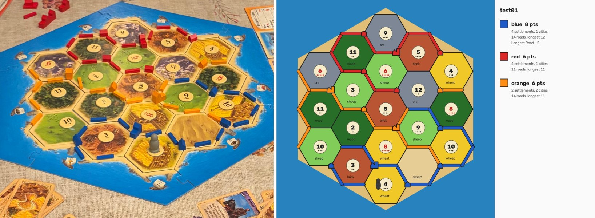
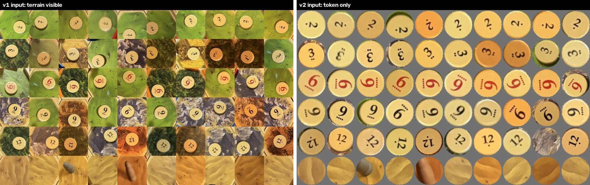

# Catan Board Visualizer

Take one photo of a physical Settlers of Catan board and get back a clean digital version of it, plus every player's visible score.



*Left: a photo from a room the models never saw during training. Right: what the pipeline reads from it: all 19 tiles and number tokens, the roads, settlements, and cities in their players' colors, the robber, and the score panel with Longest Road.*

## What it reads

- **Tiles:** the resource on each of the 19 hexes (wood, brick, sheep, wheat, ore, desert)
- **Number tokens:** the number on each hex, including the one hidden under the robber (deduced, see below)
- **Pieces:** every road, settlement, and city, placed on its exact vertex or edge, in its player's color
- **The robber:** which hex it's on
- **Scores:** settlements (1), cities (2), and Longest Road (2), computed from the board itself

Only what's visible on the board is scored. Largest Army and victory-point cards are in players' hands.

## How it works

```
photo
 → find the board's 6 corners        corner detector + Catan tile-count check
 → rectify to a top-down board       homography onto a fixed 1000 px hex grid
 → detect pieces                     YOLO11: road, settlement, city, robber
 → color each piece                  YOLO11 classifier: red, blue, white, orange
 → snap pieces to the board          nearest vertex, edge, or tile on the hex grid
 → read the 19 hexes                 two classifiers: resource, and number token
 → fill in hidden numbers            deduction from Catan's fixed token counts
 → score                             points per player, Longest Road by graph search
 → render                            a clean digital board and score panel
```

| stage | method | held-out accuracy (Round 3) |
|---|---|---|
| piece detection | YOLO11s fine-tuned on hand-labeled photos | mAP50-95 0.85, city recall 0.93 |
| piece color | YOLO11n classifier on 2,071 reviewed crops | 100% |
| tile resource | YOLO11n classifier on rectified hex crops | 100% |
| number token | YOLO11n classifier on isolated token crops | 100% |
| numbers end to end, after deduction | | 99.5% of 1,026 tokens across all labeled photos, 43 of 43 hidden tokens deduced correctly |
| automatic corners end to end | | 53 of 55 accepted boards give the same scores as hand-placed corners; 3 of 58 photos need manual corners |

## Engineering highlights

The models were the easy part. Most of the accuracy came from data quality and from checking answers against the rules of the game.

- **Better labels beat a better model.** City recall went from 0.78 to 0.93 by reviewing auto-generated labels and masking piles of spare pieces, with no change to the model or its settings.
- **Shortcut learning, found and fixed.** The first number-token model scored about 80% and got every 12 wrong: with only two training layouts, it had learned the terrain under each token instead of the digit (a 12 on brick was read as 4, because brick held a 4 in training). Isolating the token with circle detection and masking out the terrain took it to 100%. 
- **Game rules as safety checks.** Every board must have exactly 4 wood, 4 sheep, 4 wheat, 3 brick, 3 ore, and 1 desert, and one 2, one 12, and two of each other number. Those counts validate automatic corners (wrong corners produce impossible tile counts), deduce the token under the robber, and refuse to guess when the answer isn't certain.
- **A model can be confidently wrong because a label was wrong.** A settlement rendered blue in one photo was orange. Its training label said blue, so the color classifier had learned the mistake and was 99.8% sure. The audit against labels passed, because the labels were the problem. A Catan rule (a building touches at least one road of its own color) found it and one other bad label.
- **Never guess silently.** An unreadable token becomes "?", failed corners ask the user instead of producing a wrong board, and deduction only fills in a number when exactly one answer is possible.
- **Longest Road** is a depth-first search with backtracking over each player's road graph. A trail can revisit a vertex but never reuse a road, and an opponent's settlement or city cuts it.

The full story, with every experiment, failure, and number, is in [docs/progress/README.md](docs/progress/README.md).

## Running it

Requires Python 3.14; an NVIDIA GPU is recommended. Install the pinned versions with `pip install -r requirements.txt` (it pulls the CUDA 13.0 build of PyTorch from the PyTorch package index).

The trained weights are not in the repository (`runs/` is git-ignored), so the models have to be trained first; see the training section below.

Read one photo, from the repo root:

```
python -m pipeline.read_board path/to/photo.jpg
```

It prints the pieces and scores and saves the rendered board to `outputs/boards/`. If the corners can't be found automatically, a window opens to click the 6 corners by hand.

All scripts run as modules from the repo root (`python -m package.module`).

## Project structure

```
pipeline/     runs on a photo: read_board, corners, rectify, board, snap, hexes, tokens, layout, score, render
data_prep/    labeling tools and dataset builders
training/     training scripts for each model
data/         hand-made labels: corner clicks, round layouts, tile labels, piece colors
docs/         progress log and images
```

### Training

The piece dataset was labeled in Roboflow (auto-labeled, then reviewed) and exported in YOLOv11 format. Everything else is built from the hand labels in `data/`:

```
python -m data_prep.apply_masks             # turn spare-piece piles into masked regions
python -m training.train                    # piece detector

python -m data_prep.extract_crops           # one crop per labeled piece
python -m data_prep.build_color_dataset
python -m training.train_color              # piece color

python -m pipeline.layout                   # each photo's rotation vs its round's empty board
python -m data_prep.build_tile_datasets
python -m training.train_tiles              # tile resource
python -m training.train_tokens             # number token

python -m data_prep.build_corner_dataset
python -m training.train_corners            # board corners
```

## Data

58 photos across 3 rounds of staged games, about 20 photos per round, each round a new tile and number layout, shot while walking around the table. Each round starts with an empty-board photo used to label its 19 tiles once; that labeling is carried to every other photo in the round by matching the board's rotation. Rounds 1-2 are for training and Round 3 is held out for every reported accuracy.

## Status and limitations

- Works end to end: photo in, board and scores out, with automatic corners and a manual fallback.
- All training photos come from one table, mostly in the evening. The one photo from a different room gets every tile, number, and score right with hand-placed corners, but misses one road that's half hidden behind a settlement, and its automatic corners are off enough to misplace two pieces. More varied photos are the next step, starting with the corner detector.
- Planned: a web page where a phone takes the photo and shows the board and scores, with draggable corners when the automatic ones fail.
